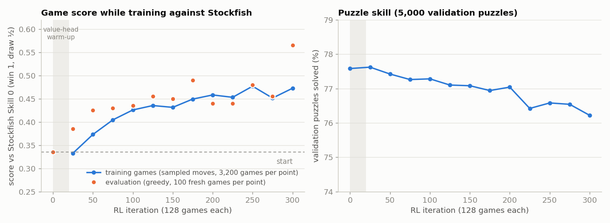

# DL-based Sudoku & RL-based Chess


Two game-playing agents trained on large public datasets and evaluated on held-out test sets:

| | Sudoku | Chess |
|---|---|---|
| Learning | **Deep learning** (supervised): a network predicts the digit of every empty cell | **Reinforcement learning**: policy gradient on puzzles and then in full games against Stockfish, after a supervised warm start |
| Dataset | [Sudoku-Extreme](https://huggingface.co/datasets/sapientinc/sudoku-extreme): 3.83M train / 423k test puzzles | [Lichess puzzle database](https://database.lichess.org/#puzzles) ([HF mirror](https://huggingface.co/datasets/Lichess/chess-puzzles)), CC0: 6.16M rated puzzles |
| Model | `SudokuConstraintNet`, 3.4M params (plus a plain CNN baseline) | `ChessNet`, 10×128 residual tower with policy and value heads, 11.6M params |
| Test metric | puzzles solved completely and correctly | Lichess puzzles solved (every solver move right), score in games vs. Stockfish |

**Results on the held-out test sets** (no search in either agent):

- **Sudoku:** the fine-tuned `SudokuConstraintNet` solves **54.5%** of the 422,786 Sudoku-Extreme test
  puzzles completely: all of the easy Kaggle ones, 89% of uniformly random ones and 27% of the forum's
  hardest list. The plain CNN this repo started with solves 8.5%.
- **Chess:** reinforcement learning in full games against Stockfish raised the agent's score against
  Stockfish Skill Level 0 from **0.335 to 0.515** (200 fresh games each, roughly +130 Elo), and nearly
  doubled it against Skill Level 2, which it never trained against (0.095 → 0.175). On 61,833 Lichess test
  puzzles all versions solve 75–76% (about a 1935 puzzle rating); RL on the puzzles themselves only adds
  +0.4 points over the supervised start, and I explain below why.

---

## Contents

- [Datasets, and why these ones](#datasets-and-why-these-ones)
- [Sudoku: deep learning](#sudoku-deep-learning)
- [Chess: reinforcement learning](#chess-reinforcement-learning)
- [Results](#results)
- [Reproduce](#reproduce)
- [Project structure](#project-structure)

---

## Datasets, and why these ones

### Sudoku-Extreme (`sapientinc/sudoku-extreme`)

The first version of this repo used the Kaggle "1M Sudoku" set, but that set is too easy to show anything:
every puzzle in it can be finished by repeatedly filling cells that have only one legal digit, so a network
gets high accuracy without learning to reason (the no-network baseline below solves 99.99% of them).
Sudoku-Extreme collects puzzles from several community sources and keeps the source of each puzzle, so I
can report accuracy separately for easy and very hard puzzles:

| Source | What it is |
|---|---|
| `puzzles0_kaggle` | the Kaggle 1M set (easy) |
| `puzzles1_unbiased` | uniformly sampled random puzzles |
| `puzzles2_17_clue` | 17-clue puzzles (the minimum possible number of clues) |
| `puzzles3_magictour` | Magictour "top" hard puzzles |
| `puzzles4/5/6_forum_hardest_*` | the Sudoku forum's hardest-puzzle lists |
| `01_file1` | a large extra collection that the dataset lists under this name |

Every puzzle has a unique solution. The official split has 3,831,994 training and 422,786 test puzzles,
with no puzzle in both. I hold out 10,000 training puzzles for validation and checkpoint selection, and
the test split is only used for the final numbers.

Rejected alternatives: Kaggle 1M/3M (easy, see above); `Sudoku-1M-Puzzles`-style generated sets (generated
from one seed grid, and solutions are not guaranteed to be unique).

### Lichess puzzle database (`Lichess/chess-puzzles`)

Each of the 6.16M puzzles comes from a real game. It has the position, the forced solution line (verified
by Stockfish) and a Glicko-2 rating from millions of attempts by Lichess players. That makes it a natural
RL environment with a clear reward (solved or not), and its ratings let the agent's strength be expressed
on the same scale as human puzzle ratings.

Puzzles are split by a hash of their `PuzzleId` (`crc32(id) % 1000`), so the split is stable when Lichess
adds puzzles:

| Split | Puzzles | Used for |
|---|---|---|
| `sup` | 4,827,594 | supervised warm start (imitation of solution moves) |
| `rl` | 1,206,067 | reinforcement learning (reward only, solution moves never shown) |
| `val` | 61,847 | checkpoint selection |
| `test` | 61,833 | final evaluation only |

---

## Sudoku: deep learning

**Input / output.** The board is one-hot encoded (9 channels × 9 × 9, an empty cell is all zeros). The
network outputs 9 logits per cell. The loss is cross-entropy on the empty cells only.

**`SudokuConstraintNet`** (`sudoku/model.py`). A convolution cannot see a whole row, column or box, but
those 27 groups are exactly what Sudoku rules are about. Each residual block therefore does a 3×3
convolution, then mean-pools the features of every row, column and box and broadcasts them back to the
cells of that group, so after one block every cell has seen every cell that constrains it. 16 blocks ×
128 channels, 3.4M parameters. `SudokuCNN` (9 plain 3×3 conv layers, the original model of this repo) is
trained in exactly the same way as a baseline.

**Augmentation.** Every training batch gets a random Sudoku symmetry on the GPU: digit relabelling, row
permutations within bands, band permutations, and transposition. Each one turns a valid puzzle into
another valid puzzle.

**Decoding** (`sudoku/infer.py`):
- *one-shot*: fill all empty cells at once with the network's best digit;
- *iterative*: fill only the single most confident cell whose digit is still legal, then run the network
  again on the new board, and repeat until the board is full. There is no backtracking and no search: a
  wrong guess is never undone.

A board counts as solved only if it is complete, obeys every rule and keeps all the clues.

**Fine-tuning on partly solved boards.** Iterative decoding keeps feeding the network boards that it has
filled in itself, but during training it only ever saw original puzzles. So I fine-tuned the trained
model for 10k more steps (`--reveal-frac 0.5`): on half of every batch, a random share of the blank cells
is filled with the true digits first, so the network also learns from "many digits filled, still hard"
boards. On the validation puzzles this raised iterative accuracy from 40.6% to 50.7%.

**No-network baseline.** Iterative decoding with all scores equal (`uniform` in `sudoku/evaluate.py`) is
pure constraint propagation: it fills cells that have a single legal digit and otherwise guesses. It shows
how much of the accuracy the trained network actually contributes.

---

## Chess: reinforcement learning

**Environment** (`chess_rl/puzzles.py`). In a Lichess puzzle, the FEN is the position before the
opponent's move. `Moves[0]` is the opponent's move, then solver and opponent moves alternate. The agent
must play every solver move. The episode ends with reward 1 when the line is complete, and with reward 0
at the first wrong move. As on Lichess, any move that gives checkmate is accepted.

**Encoding** (`chess_rl/encoding.py`). 17 input planes from the side to move's point of view (12 piece
planes, 4 castling-right planes, 1 en-passant plane; the board is mirrored when Black is to move). There are 4,168 actions: from-square ×
to-square plus 72 under-promotions. Illegal moves are masked out. The encoding was checked on 372,907
real moves.

**Model** (`chess_rl/model.py`). A 10-block × 128-channel residual tower with a policy head (4,168 logits)
and a value head (probability of solving the puzzle from this position; in game RL, the expected game
score), 11.6M parameters.

**Training.**
1. *Supervised warm start* (`chess_rl/train_supervised.py`): imitation of solution moves from the `sup`
   split (11.2M positions). This is the AlphaGo recipe: a policy that already plays sensible chess before
   RL starts.
2. *Puzzle RL* (`chess_rl/train_rl.py`) on the `rl` split. The agent samples moves from its own policy,
   and the only learning signal is the solved/failed reward. I tried two versions:
   - **v1** (`chess_rl.pt`): REINFORCE with the value head as a learned baseline,

     `L = -(R - V(s)) · log π(a|s)  +  c_v · BCE(V(s), R)  +  c_kl · KL(π ‖ π_warm-start)  -  c_ent · H(π)`

     The first 100 iterations train only the value baseline, so advantages are calibrated before the policy
     changes. The KL term keeps the policy close to the warm start: without it, the policy's entropy
     collapsed in my first short test run. BatchNorm statistics are frozen during RL.
   - **v2** (`chess_rl_v2.pt`): in v1 a failed puzzle punishes *every* move of the attempt, including the
     correct ones before the mistake. In v2 each puzzle is played 8 times. Since the opponent's replies are
     fixed, the attempts form a small tree, and each move gets the advantage
     `V(node after the move) − V(node before)`, where V is the success rate of the attempts through that
     node. A wrong move gets the blame and the correct moves before it get credit, with no value network
     needed. Training uses only puzzles rated ≥ 1300 (the easier ones are already solved ~99% of the time).
3. *Game RL* (`chess_rl/train_games.py`), starting from v1: 128 games per iteration against Stockfish at
   Skill Level 0, half as White and half as Black, with the agent sampling its moves. The reward is the game
   score (win 1, draw ½, loss 0). To tell the agent sooner *which* move lost the game, I add
   potential-based shaping with the material balance (Ng et al., 1999: this kind of shaping does not
   change which policy is optimal), and compute advantages with GAE(λ = 0.9) along each game. The value
   head is first retrained for 20 iterations to predict the game score, and the same KL leash is used.
   300 iterations (38,400 games, 90 minutes).

**Evaluation** (`chess_rl/evaluate.py`). The greedy policy, with no search, plays the 61,833 test puzzles.
The metrics are first-move accuracy, full-solve rate, the solve rate per rating bucket, and an estimated
puzzle rating: the rating *R* that maximises the likelihood of the observed results under the Elo model
`P(solve) = 1 / (1 + 10^((puzzle_rating − R)/400))`. Every model also plays 200 full games against a
random mover, against Stockfish 19 at Skill Level 0 (the game-RL training opponent) and against Stockfish
at Skill Level 2 (never trained against), 10 ms per move, alternating colours, draw after 300 plies.

---

## Results

All numbers below are on the held-out **test** splits, which were not used for training or checkpoint
selection. Raw outputs: [`results/sudoku_results.json`](results/sudoku_results.json),
[`results/chess_results.json`](results/chess_results.json). Training curves are in
`checkpoints/*.log.jsonl`. Hardware: one laptop RTX 4050 (6 GB).

### Sudoku: 422,786 Sudoku-Extreme test puzzles

| Model | Params | Blank cells right (one pass) | Solved, one-shot | Solved, iterative | **Solved, best of both** |
|---|---|---|---|---|---|
| No network (constraint propagation + guessing) | 0 | 11.1% | 0.0% | 4.4% | 4.4% |
| `SudokuCNN`, 9 conv layers (`sudoku_cnn.pt`) | 265k | 46.0% | 0.0% | 8.5% | 8.5% |
| `SudokuConstraintNet` (`sudoku_constraint.pt`) | 3.4M | 73.7% | 22.3% | 40.8% | 48.2% |
| **+ fine-tune on partly solved boards** (`sudoku_constraint_ft.pt`) | 3.4M | **74.1%** | **23.5%** | **49.9%** | **54.5%** |

"Best of both" uses the one-shot board if it passes the rule check (rules and clues only, the solution is
never looked at), and otherwise the iterative board. Every puzzle has exactly one solution, so a board that
passes the check is the right one.

By source (solved, best of both), with an exact backtracking solver as a reference:

| Source | Test puzzles | No network | CNN | ConstraintNet | **+ fine-tune** | Backtracking, ≤ 5 s per puzzle* |
|---|---|---|---|---|---|---|
| `puzzles0_kaggle` | 9,954 | 99.99% | 98.9% | 100% | **100%** | 100% |
| `puzzles1_unbiased` | 99,749 | 7.5% | 25.1% | 88.7% | **89.3%** | 96% |
| `puzzles2_17_clue` | 4,855 | 0.2% | 3.0% | 95.4% | **96.2%** | 7% |
| `01_file1` | 93,552 | 0.7% | 0.2% | 65.3% | **73.1%** | 68% |
| `puzzles3_magictour_top1465` | 143 | 0.0% | 2.1% | 53.1% | **54.5%** | 59% |
| `puzzles4_forum_hardest_1905` | 209,601 | 0.2% | 0.4% | 18.4% | **27.2%** | 51% |
| `puzzles5_forum_hardest_1905_11+` | 4,887 | 0.1% | 0.4% | 15.8% | **22.2%** | 39% |
| `puzzles6_forum_hardest_1106` | 45 | 0.0% | 0.0% | 6.7% | **24.4%** | 22% |

\* 100 random puzzles per source (all 45 for the last one). The backtracking solver in this repo is plain
recursion with no candidate heuristics, so it times out a lot on the hard sources and on the 17-clue
puzzles (few clues means a huge search tree for it). A good solver (e.g. dancing links) solves every one of
these in milliseconds. The point of the comparison is that the network does **no search at all**: it never
undoes a guess.

Some things I noticed:
- The network clearly learns something the rules alone don't give: constraint propagation plus guessing
  only gets the easy Kaggle puzzles.
- Seeing whole rows, columns and boxes matters a lot. The plain CNN gets 46% of the cells right, but a board
  has ~56 blanks, so it almost never gets a whole board.
- The fine-tune helped most where it should: on the hardest sources, where iterative decoding fills many
  cells before it gets stuck (forum hardest 18.4% → 27.2%).
- On `01_file1`, one-shot (57.9%) actually beats iterative (52.8%), which is why "best of both" is worth it
  there.
- To be upfront: I added the fine-tuning step after a first test run of `sudoku_constraint.pt`, after seeing
  that iterative decoding made confident mistakes on partly filled boards. The fine-tuned checkpoint was
  picked on validation like the others and then tested once.

### Chess: 61,833 Lichess test puzzles (greedy policy, no search)

| Model | First move correct | **Puzzle solved** (whole line) | Estimated puzzle rating |
|---|---|---|---|
| Random legal moves | 5.4% | 0.8% | ≤ 400 |
| Supervised warm start (`chess_supervised.pt`) | 85.5% | 75.7% | 1925 |
| + puzzle RL v1 (`chess_rl.pt`) | **86.0%** | 76.2% | **1935** |
| + puzzle RL v2, tree advantage (`chess_rl_v2.pt`) | 85.9% | **76.2%** | **1935** |
| v1 + game RL (`chess_rl_games.pt`) | 85.1% | 75.3% | 1915 |

By puzzle rating (solve rate):

| Lichess rating | Puzzles | Random | Supervised | RL v1 | RL v2 | Game RL |
|---|---|---|---|---|---|---|
| < 1000 | 14,193 | 1.6% | 99.0% | 99.2% | 99.1% | 98.9% |
| 1000–1500 | 19,901 | 0.8% | 92.7% | 94.0% | 93.4% | 92.5% |
| 1500–2000 | 15,948 | 0.4% | 69.3% | 69.8% | 70.2% | 68.7% |
| 2000–2500 | 9,484 | 0.3% | 32.4% | 31.6% | 32.5% | 31.4% |
| ≥ 2500 | 2,307 | 0.3% | 9.4% | 8.3% | 8.6% | 8.6% |

**What puzzle RL adds: very little, and why.** RL v1 improves the solve rate by 0.44 points over its
supervised starting point. The gain is small but statistically clear: on the same 61,833 puzzles, RL solves
1,523 that the warm start misses, and the warm start solves 1,252 that RL misses (paired McNemar test,
z = 5.1, p ≈ 3·10⁻⁷). v2 fixes the credit assignment of v1 and trains on harder puzzles, but it ends at
exactly the same place (76.85% vs. 76.85% on 20,000 validation puzzles, 76.20% vs. 76.18% on test). My
explanation: in a puzzle the positions are fixed by the puzzle line, so the only thing RL can discover is
the solution move, which the supervised stage was already trained on, from four times as many puzzles. A
better RL algorithm cannot get around that.

### Chess: full games (200 games per pairing, greedy policy, no search)

| Model | vs. random mover (W / D / L) | vs. Stockfish Skill 0 (W / D / L) | **Score** | vs. Stockfish Skill 2, never trained against (W / D / L) | **Score** |
|---|---|---|---|---|---|
| Supervised | 180 / 20 / 0 | 58 / 47 / 95 | 0.408 | 7 / 23 / 170 | 0.093 |
| + puzzle RL v1 | 188 / 12 / 0 | 47 / 40 / 113 | 0.335 | 6 / 26 / 168 | 0.095 |
| + puzzle RL v2 | 189 / 11 / 0 | 45 / 53 / 102 | 0.358 | 8 / 19 / 173 | 0.088 |
| **v1 + game RL** | 189 / 11 / 0 | **84 / 38 / 78** | **0.515** | **15 / 40 / 145** | **0.175** |

This is where RL makes a real difference. Against Stockfish Skill 0, game RL moves the score from 0.335 to
0.515: the agent now wins more games than it loses. The standard error of each score is about 0.03, so the
difference is about 4 standard errors, and it is roughly +130 Elo against that opponent. Against Skill
Level 2, which it never played during training, the score also goes from 0.095 to 0.175 (about 3 standard
errors), so it learned to play better chess, not just to exploit one opponent. The price is a small loss on
puzzles (76.2% → 75.3%), because the policy moves away from pure tactics.



The checkpoint is the one with the best 100-game evaluation during training (here the last one,
iteration 300). The 200 games in the table are new games played after training.

A correction to the first version of this README: it reported 0.21 for the supervised model and 0.32 for
puzzle RL v1 against Stockfish, from 100 games each, and said puzzle RL helped in games. That was noise. In
two replays the supervised model scored 0.34 and 0.41, and v1 between 0.30 and 0.335, so puzzle RL makes
no real difference in games.

The draws against the random mover are threefold repetitions. The network sees no move history, so it
cannot tell that it is repeating a position.

### Limitations

- The Sudoku network never backtracks, so it still fails about 3 out of 4 of the forum's hardest puzzles.
  Adding a small search on top of its digit scores would be the obvious next step.
- The chess agent is a pure policy network. It does no search (no MCTS or alpha-beta), which is why it
  is still far below engine strength: it loses most games to Stockfish at Skill Level 2. Using the
  game-trained value head inside a search is the obvious next step.
- Game RL trained against one opponent only (Stockfish Skill 0). The Skill 2 result shows that some of it
  carries over, but self-play or a mix of opponents would be more general.
- The network sees no move history, so it cannot avoid threefold repetitions in won positions.

---

## Reproduce

```bash
git clone https://github.com/BavanPrabahar/dl-based-sudoku-rl-based-chess.git
cd dl-based-sudoku-rl-based-chess
python3 -m venv .venv && source .venv/bin/activate
pip install -r requirements.txt

# 1. data (~1 GB download): Sudoku-Extreme CSVs + Lichess puzzle parquet -> data/processed/
python scripts/download_data.py

# 2. Sudoku
python -m sudoku.train --arch constraint --steps 40000 --eval-every 4000 --save checkpoints/sudoku_constraint.pt
python -m sudoku.train --init checkpoints/sudoku_constraint.pt --reveal-frac 0.5 --steps 10000 --lr 5e-4 \
       --eval-every 2000 --save checkpoints/sudoku_constraint_ft.pt     # fine-tune on partially solved boards
python -m sudoku.train --arch cnn --layers 9 --hidden 64 --steps 40000 --eval-every 4000 --save checkpoints/sudoku_cnn.pt
python -m sudoku.evaluate --checkpoints uniform checkpoints/sudoku_cnn.pt checkpoints/sudoku_constraint.pt \
       checkpoints/sudoku_constraint_ft.pt

# 3. Chess
python -m chess_rl.train_supervised --steps 30000 --save checkpoints/chess_supervised.pt
python -m chess_rl.train_rl --init checkpoints/chess_supervised.pt --group 1 --puzzles 1024 --min-rating 0 \
       --value-warmup 100 --c-kl 0.1 --lr 3e-5 --iters 1500 --val-size 10000 --save checkpoints/chess_rl.pt     # v1
python -m chess_rl.train_rl --init checkpoints/chess_supervised.pt --save checkpoints/chess_rl_v2.pt          # v2
python -m chess_rl.train_games --init checkpoints/chess_rl.pt --stockfish /path/to/stockfish \
       --save checkpoints/chess_rl_games.pt                                                                     # game RL
python -m chess_rl.evaluate --models random checkpoints/chess_supervised.pt checkpoints/chess_rl.pt \
       checkpoints/chess_rl_v2.pt checkpoints/chess_rl_games.pt --games 200 \
       --stockfish /path/to/stockfish --skills 0 2
python scripts/plot_game_rl.py                   # training curve figure (needs matplotlib)
```

Training logs are written next to each checkpoint (`checkpoints/*.log.jsonl`). The trained checkpoints and
logs are included in the repository, so you can skip steps 2 and 3 and use them directly:

```bash
# solve a puzzle (0 or . = empty): backtracking vs. the network, one-shot and iterative
python -m sudoku.solve --puzzle "530070000600195000098000060800060003400803001700020006060000280000419005000080079"

# play against the chess agent (the game-RL model) in the terminal: moves as e4, Nf3, O-O or e2e4; commands undo, hint, quit
python -m chess_rl.play            # you play White
python -m chess_rl.play --black    # you play Black (board shown from Black's side)
python -m chess_rl.play --selfplay # watch the agent play itself
```

`sudoku_ai_solver.ipynb` is the original self-contained tutorial notebook (small CNN on the sample CSV).

---

## Project structure

```text
dl-based-sudoku-rl-based-chess/
├── sudoku/
│   ├── model.py                 SudokuConstraintNet, SudokuCNN, checkpoint loading
│   ├── dataset.py               Sudoku-Extreme preparation, one-hot encoding, symmetry augmentation
│   ├── infer.py                 one-shot and iterative decoding, rule checks
│   ├── train.py                 training loop (bf16, validation on held-out train puzzles)
│   ├── evaluate.py              test-set evaluation per source + backtracking reference
│   ├── solve.py                 solve one puzzle from the command line
│   ├── backtracking_solver.py   exact recursive solver
│   ├── board_utils.py           board printing and rule helpers
│   └── demo_activation_solve.py rule-based illustration of argmax over digit scores
├── chess_rl/
│   ├── encoding.py              board -> planes, move <-> action index, legal masks
│   ├── model.py                 ChessNet (policy + value)
│   ├── puzzles.py               Lichess puzzle environment, splits, supervised samples
│   ├── agent.py                 batched greedy / sampled play
│   ├── train_supervised.py      stage 1: warm start
│   ├── train_rl.py              stage 2: policy-gradient RL on puzzles (v1 and v2)
│   ├── train_games.py           stage 3: RL in full games against Stockfish
│   ├── evaluate.py              test puzzles, rating estimate, games
│   └── play.py                  play against the agent in the terminal (or watch self-play)
├── scripts/
│   ├── download_data.py         dataset download and preprocessing
│   └── plot_game_rl.py          game-RL training curve
├── docs/game_rl_curve.png       figure used in this README
├── checkpoints/                 trained weights + training logs
├── results/                     evaluation JSON files
├── data/sample_sudoku.csv       5 example puzzles
└── sudoku_ai_solver.ipynb       original tutorial notebook
```

## License

MIT. The datasets have their own licenses: the Lichess puzzle database is CC0. Sudoku-Extreme is
distributed by Sapient Intelligence on Hugging Face.

---
*Maintained by [BavanPrabahar](https://github.com/BavanPrabahar)*
